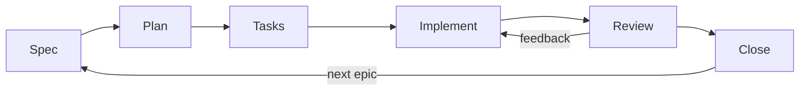

# AgileSDD Plus

*[Leer en español](README.es.md)*

A lean, installable starter for building software with AI agents using **Agile + Spec Driven Development**, with an **independent reviewer** that checks every user story against its acceptance criteria.

It merges two projects:

- **[AgileSDD](https://github.com/titozeio/AgileSDD)**: a lean, product-shaped workflow (roadmap → epics → user stories → tasks) with the human PM approving every step.
- **devAgent**: a multi-agent OpenSpec pipeline whose strongest ideas are independent judges, deterministic verdicts and stack-aware audit catalogs.

AgileSDD Plus keeps the agile loop as the backbone and imports only the quality mechanisms that do not add ceremony. Every decision and its origin are documented in [`docs/DECISIONS.md`](docs/DECISIONS.md).

## Quick start

```bash
npx create-agile-sdd-plus my-project
cd my-project
```

Then open your agent (Claude Code, Antigravity or OpenCode) and type `/sdd`. The agent reads the roadmap, sees that `EPIC0` is in `implement`, and starts interviewing you to fill the specs, architecture and roadmap. It does not guess: the scaffold files are placeholders.

Options:

```bash
npx create-agile-sdd-plus . --force                    # install into an existing repo, overwriting scaffold files
npx create-agile-sdd-plus my-project --yes             # no prompts, recommended defaults
npx create-agile-sdd-plus my-project --no-skills       # only the mandatory grill-me skill
npx create-agile-sdd-plus my-project --platforms claude,antigravity   # or all / none
```

Existing files are never overwritten unless you pass `--force`.

## The cycle

One sprint = one epic. One user story at a time.



| Phase | What happens | Exit |
| --- | --- | --- |
| Spec | Clarify with `grill-me` (one question at a time); write user stories with acceptance criteria `ACn.m` (Given/When/Then) | PM agrees; every US meets the Definition of Ready |
| Plan | Order user stories by value and dependency | PM approves |
| Tasks | Split each US into small tasks traced to its AC | PM approves |
| Implement | Smallest useful change per task, tests first, Definition of Done | PM moves the epic to review |
| Review | Independent reviewer per US, then PM review | PM approves every US |
| Close | Update the living spec `specs/CAPABILITIES.md`, the changelog and a three-line retro | Epic `done` |

## What gets installed

```text
AGENTS.md                 short constitution (~6 KB): rules, DoR, DoD, write scope
CLAUDE.md                 imports AGENTS.md for Claude Code
docs/
  METHODOLOGY.md          per-phase playbook: agents read one section at a time
  ROADMAP.md              epics, statuses and backlog
  ARCHITECTURE.md         stack, structure, test command, developer practices
  GLOSSARY.md  CHANGELOG.md
specs/
  SPECS.md                what, why, how, non-goals
  CAPABILITIES.md         living spec: what the system does today
  EPIC0/                  EPIC0.md, PLAN.md, TASKS.md (templates for every epic)
skills/
  grill-me/  zoom-out/  tdd/  debugging/
  review/                 reviewer protocol + catalogs/ (stack audit rules)
.claude/  .agent/  .opencode/   thin slash commands and the sdd-reviewer agent
```

## Commands

| Command | Skill | Default mode |
| --- | --- | --- |
| `/sdd` | resume the workflow from the roadmap | always |
| `/grillme` | clarification, one question at a time | `auto` (mandatory) |
| `/zoomout` | consistency review before implementing | `manual` |
| `/tdd` | red-green-refactor | `manual` |
| `/sdd-review EPIC2/US1` or `/sdd-review spec EPIC2` | independent review | `auto` |
| `/sdd-debug` | root-cause debugging | `manual` |

`auto` skills run when the phase calls for them; `manual` ones only on request. Modes are chosen at install time.

The commands are thin wrappers generated for each platform. They only point to `skills/*/SKILL.md`, so there is one source of truth and the platforms cannot drift apart.

## The independent reviewer

Before the PM reviews a user story, the main session hands the `sdd-reviewer` subagent **file paths, not summaries**: the epic, its tasks, the architecture and the changed files. With a fresh context, the reviewer:

1. runs the test command from `docs/ARCHITECTURE.md`;
2. builds a traceability table: each acceptance criterion → implementation → test;
3. audits only new or modified code (scope fence): complexity, duplication, naming, injection, layer rules;
4. applies the stack catalogs the changed files activate;
5. returns a mechanical verdict and appends it to `specs/EPICX/REVIEW.md`.

| Verdict | Rule |
| --- | --- |
| `REJECTED` | at least one CRITICAL finding |
| `CHANGES_REQUESTED` | no CRITICAL, at least one MAJOR |
| `APPROVED` | no CRITICAL, no MAJOR |
| `NOT_VERIFIED` | an essential check could not run; never an approval |

A check that did not run is `N/A` with a reason, never `PASS`.

**Catalogs included:** PHP, Python, C#, Java, JavaScript, TypeScript, CSS (languages) · Symfony, Laravel, MAUI, Spring Boot, Swing (frameworks) · Twig, Blade (templates). Adding a stack means adding one file; see `skills/review/catalogs/README.md`.

## Guard rails

- **Closed epics are read-only.** In Claude Code, the `sdd-guard` hook (`.claude/settings.json`) blocks edits to `specs/EPICn/` once the roadmap marks that epic `done`. It has no dependencies and fails open, so a broken guard never blocks your session.
- **Docs first.** Scope changes update the epic and its acceptance criteria before the code.
- **Git belongs to the developer.** Agents suggest commit messages (`[EPICX][Tn] summary`) and never commit unless asked.

## Platform support

| Platform | Installed files | Status |
| --- | --- | --- |
| Claude Code | `CLAUDE.md`, `.claude/commands/`, `.claude/agents/sdd-reviewer.md`, `.claude/settings.json` + hook | built on the documented formats; pending a full pilot |
| Antigravity | `.agent/workflows/`, `.agent/agents/sdd-reviewer.md` | format taken from devAgent; not yet verified in a real installation |
| OpenCode | `.opencode/commands/`, `.opencode/agents/sdd-reviewer.md` (reads `AGENTS.md` natively) | format taken from devAgent; not yet verified in a real installation |

Any agent that can read `AGENTS.md` can follow the workflow without the adapters.

The reviewer runs on `sonnet` in Claude Code and `flash` in Antigravity. Raise them (`opus`, `pro`) in the agent file if your plan allows it.

## How it compares

| | AgileSDD 0.8 | devAgent | AgileSDD Plus |
| --- | --- | --- | --- |
| Product layer (roadmap, epics, stories) | yes | no (one change at a time) | yes |
| Verifiable acceptance criteria | no | yes (OpenSpec scenarios) | yes (`ACn.m`, Given/When/Then) |
| Independent review | PM only | two judge agents | one reviewer agent + PM |
| Stack-aware audit | no | catalogs | catalogs + Java, Spring Boot, Swing |
| Living spec of current behavior | no | yes (OpenSpec main specs) | yes (`CAPABILITIES.md`) |
| Enforced write rules | no | Antigravity hook | Claude Code hook |
| Process an agent loads per session | ~14 KB | ~60 KB + 35 KB per judge | ~10 KB (+5 KB to review) |
| External dependencies | none | OpenSpec CLI ≥ 1.11 | none |

What devAgent still does better: machine-validated spec deltas through the OpenSpec CLI, judges on a different model family (OpenCode variant), and automatic documentation with governance rules. If you need those, use devAgent. The trade-offs are explained in [`docs/DECISIONS.md`](docs/DECISIONS.md).

## Development

```bash
npm test                                   # 14 tests, Node 18+, no dependencies
node ./bin/create-agile-sdd-plus.cjs ../sandbox-project
```

The tests check, among other things, that every doc path the scaffold mentions exists, that catalogs compose correctly, that no template is hidden by `.gitignore`, and that the guard blocks and fails open as designed. Repo conventions for contributors and agents are in `AGENTS.md`; progress is in `docs/WORKLOG.md`.

## Credits

- **AgileSDD** by Sergio Montes ([titozeio/AgileSDD](https://github.com/titozeio/AgileSDD), MIT): the workflow, the scaffold and the CLI this fork is built on.
- **devAgent** by antoniov-sandiez and contributors (MIT): audit catalogs and the review and debugging protocols.
- **[mattpocock/skills](https://github.com/mattpocock/skills)** by Matt Pocock (MIT): the original `grill-me`, `zoom-out` and `tdd` skills.

## License

MIT. See [`LICENSE`](LICENSE).
