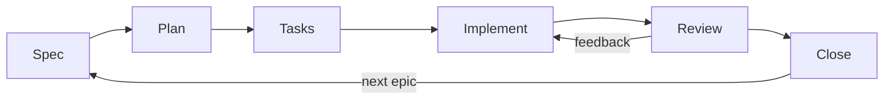

# Methodology Playbook

Read only the section of the phase the current epic is in (see `docs/ROADMAP.md`). Every phase ends with PM approval and leaves enough written context for the next one to continue without guessing.

| Phase | Output | Exit condition |
| --- | --- | --- |
| Spec | `specs/EPICX/EPICX.md`: problem, non-goals, US + acceptance criteria | PM agrees, every US meets the Definition of Ready |
| Plan | `specs/EPICX/PLAN.md`: US order, dependencies, decisions | PM approves, plan `closed` |
| Tasks | `specs/EPICX/TASKS.md`: tasks per US, traced to AC | PM approves, tasks `closed` |
| Implement | code + tests, tasks `[<]` | every task implemented, PM allows review |
| Review | `specs/EPICX/REVIEW.md`, tasks `[x]` | PM approves every US |
| Close | `specs/CAPABILITIES.md`, `docs/CHANGELOG.md`, retro | PM confirms, epic `done` |

---

## Spec

1. Check whether `specs/EPICX/EPICX.md` exists.
   - Exists but incomplete: report its state and ask the PM whether to help finish it.
   - Does not exist: create the folder from the `EPIC0` templates and define the epic with the PM.
2. Clarify with `grill-me` (always installed). Ask one question at a time and offer your recommended answer. Stop when the epic can be written without guessing, or when the PM asks to close the spec.
3. Write in `EPICX.md`: problem, objective, non-goals, user stories (`As a X, I want Y, so I can Z`) and, for each US, its acceptance criteria (`ACn.m`, Given/When/Then). Rewrite the PM's wording into that form when it is safe; if it is not, say what is missing.
4. Record the clarification outcome under `Agreement` (decisions, risks, open questions). This is what reviewers check the work against later.
5. Check every US against the Definition of Ready in `AGENTS.md`. Optional: `/sdd-review spec EPICX` for an independent check that the spec is implementable without unwritten knowledge.
6. When the PM agrees, mark the epic `plan` in `docs/ROADMAP.md`.

## Plan

1. Check `specs/EPICX/PLAN.md` and its status.
   - Missing: ask the PM whether they want a draft.
   - `WIP`: report its state and ask for the next step.
2. Propose the order of the user stories by value and dependency. Stay at user-story level; do not split into tasks yet. Note any delivery decision (technical approach, spikes, risks). Use `grill-me` only if the plan still needs clarification.
3. Ask for approval. Once approved, record order, dependencies, decisions, open questions and the PM approval in `PLAN.md`, mark it `closed` and mark the epic `tasks` in `docs/ROADMAP.md`.

## Tasks

1. Check `specs/EPICX/TASKS.md` and its status (same rules as Plan).
2. Split each approved US into small, actionable tasks. Each task belongs to exactly one US and names the acceptance criteria it covers: `(AC n.m)`. Every AC must be covered by at least one task. Do not invent scope; if a US cannot be split cleanly, tell the PM what is missing.
3. Optional: `zoom-out` before closing, to check consistency with the architecture and the existing code.
4. Present the breakdown, get approval, record it, mark it `closed` and mark the epic `implement` in `docs/ROADMAP.md`.

## Implement

A pending task is not a permission to execute; it is only the next one in order. An implemented task (`[<]`, `[>]`) is not a done task.

1. Take the next task in `TASKS.md`:
   - `[-]`: check the affected files, then go to step 2.
   - `[ ]`: go to step 2.
   - `[!]`: go to **Blocked tasks**.
   - All tasks implemented: ask the PM for permission to move to `review`. If granted, mark the epic `review` in `docs/ROADMAP.md`.
2. Mark it `[-]` and propose a short plan (files, approach, tests). Do not execute it yet. If it depends on missing product, scope or tech-stack decisions, ask focused questions. When the PM agrees, go to step 3.
3. Implement following the Definition of Done in `AGENTS.md`:
   - Smallest useful change. Use `tdd` if installed (`auto`: always for new behavior; `manual`: on `/tdd`).
   - Run the test command documented in `docs/ARCHITECTURE.md`. Fix failures before moving on (`debugging` skill for root-cause analysis).
   - Ask the PM for permission to mark it `[<]`, suggest a commit message (`[EPICX][Tn] 
`), then go back to step 1.

### Autonomy mode

The PM may grant autonomy for a whole US ("autonomy for US2"). Record it next to the US heading in `TASKS.md` as `(autonomy: on)`. Then plan and implement its tasks without asking at steps 2 and 3, still marking each one `[<]`. Stop and ask on any blocker, scope question or failing test you cannot fix. The review gate still applies.

### Blocked tasks

1. Mark the task `[!]` and look for open tasks in this epic that would unblock it. If they exist, move them right above it and list them: `[!] [T2] [Blocked by T0, T1]`. Report to the PM and wait.
2. If none exist, report the problem and propose unblocking tasks. If the PM agrees, create them as `[ ]`, place them above, list them as blockers, and wait for instructions.
3. When all the listed blockers are implemented, remove the list. If it is still blocked, repeat; otherwise mark it `[ ]` and implement it.

## Review

Review is done per user story, in the order of `PLAN.md`.

1. Pick the next US that still has tasks not marked `[x]`. If there is none, go to **Close**.
2. If the US has tasks not implemented yet, implement them first (Implement, step 3).
3. Mark all its tasks `[>]`.
4. **Independent review gate** (if the `review` skill is installed: automatically when `auto`, on `/sdd-review` when `manual`). Delegate to the `sdd-reviewer` subagent with file pointers only: the epic file, `TASKS.md`, `docs/ARCHITECTURE.md` and the list of files changed for this US. It writes its verdict in `specs/EPICX/REVIEW.md`.
   - `CHANGES_REQUESTED` / `REJECTED`: fix the blocking findings that are inside the US scope and run it again (max 3 rounds, then escalate to the PM).
   - `NOT_VERIFIED`: something could not be checked (for example, tests could not run). It is not an approval; tell the PM what is missing.
   - Minor findings: list them for the PM with three options: fix now, defer (add it to the backlog in `docs/ROADMAP.md`), ignore.
5. Ask the PM to review the US, showing the acceptance criteria, how each one was verified and the reviewer verdict.
   - OK: mark all its tasks `[x]` and go back to step 1.
   - Not OK: classify the feedback (see `Change Classification` in `AGENTS.md`), propose a plan and offer: a) implement it now, b) turn it into new tasks of this US (`[ ]`, after its last task), c) address it in a future sprint (mark the US `[x]` and add the item to the backlog).

## Close

1. All US are `[x]`: ask the PM for final confirmation of the epic.
2. **Reconcile docs** (docs are the source of truth, so they must describe what was really built):
   - `specs/CAPABILITIES.md`: add or update the capabilities this epic created or changed, linking to the US and AC that define them.
   - `docs/ARCHITECTURE.md`: update it if the implementation introduced a structural decision.
   - `docs/CHANGELOG.md`: add a dated entry for the epic.
3. **Retro**: write three short bullets at the end of `EPICX.md` (keep, change, action). If an action is a rule for agents, propose the change to `AGENTS.md` to the PM.
4. Mark the epic `done` with today's date in `docs/ROADMAP.md`.
5. Next epic: if one exists, mark it `spec` and start a new sprint. If not, ask the PM; new epics enter the roadmap as `new`, promoted from the backlog when they apply.
